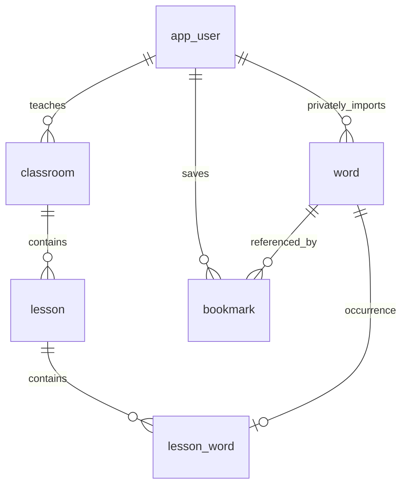

# HOME / MY VOCA implementation

## Implemented behavior
- HOME and `/my-voca` share WordbookScreen, WordRow, MaskPanel and existing filtering/masking functions.
- One functional Day dropdown in the header; data-driven options, scrollable dropdown. Search expands below the header and clears its query when closed.
- Navigation: 홈 / 학습 / 시험 / MY VOCA / 내 정보. The bookmark button uses the existing accent and icon style.
- Each screen retains its own query, expansion, MY VOCA Day and masking state across navigation, including visits to study. HOME retains its existing persisted Prefs. Account change resets screen-local state.
- Optimistic bookmark add/remove, per-word request lock, rollback and toast on failure. One context supplies both screens; stale responses cannot overwrite a new account.
- Authenticated word catalogs feed the existing study flow as well as HOME. Common server words do not expose local edit/delete actions.
- Local data is preserved. The explicit “이 기기의 기존 단어 가져오기” action copies it into the current account without deleting or overwriting the device storage. Repeated imports are idempotent and never overwrite an existing server word. No automatic claim of shared-device data occurs.
- MY VOCA distinguishes no bookmarks, no bookmarks in selected Day, and no search matches; includes a home link.

## Actual existing implementation versus design
Before this change, the frontend word catalog was only AsyncStorage and sample data. The header Day/filter buttons were disabled placeholders; removing the filter loses no implemented functionality. The backend implements JWT users and classrooms, but lesson/word/bookmark tables mentioned in its README were not implemented. V8 adds them; V1–V7 remain unchanged.

## Storage and identity
The existing AppUser/Classroom JPA entities remain unchanged. The new catalog queries use Spring JdbcTemplate and the same transactional PostgreSQL datasource, rather than introducing another database. Word payloads preserve the existing Word JSON shape (meanings, synonyms, example fields) in JSONB for compatibility.
A catalog entry is a Day occurrence. Identical spelling in separate Days has separate word IDs/bookmarks; MY VOCA does not collapse different learning contexts. Imported IDs are `legacy:<authenticated user id>:<local id>`; teacher entries receive server-generated UUIDs.

`lesson(classroom_id,chapter)` is unique; `lesson_word(lesson_id,word_id)` is primary with unique word_id; `bookmark(user_id,word_id)` is primary. Foreign keys cascade when a word, user, lesson or classroom link is removed. Words outside the student's current classroom/private ownership cannot be bookmarked or read. Old classroom bookmarks are not returned after membership changes.

## REST API
All endpoints use the existing Bearer JWT/session-refresh flow. No request accepts a client-selected bookmark owner.

| Method | Path | Body / result |
|---|---|---|
| GET | `/api/me/words` | Visible `Word[]` (private imports + assigned classroom) |
| POST | `/api/me/words/import` | Existing `Word[]`, max 2000; 204, idempotent |
| PUT | `/api/me/words/{wordId}` | Private word create/update; 204, foreign/common word 403 |
| DELETE | `/api/me/words/{wordId}` | Private owner only, cascades bookmarks; 204 |
| GET | `/api/me/bookmarks` | Visible bookmarked word IDs `string[]` |
| POST | `/api/me/bookmarks` | `{wordId}`; 204 (including duplicate), unavailable word 404 |
| DELETE | `/api/me/bookmarks/{wordId}` | 204 including already absent; deletes only caller's bookmark |
| POST | `/api/teacher/classrooms/{classroomId}/words` | `Word[]`; 201 `{created}`; owning teacher only |

Invalid word payloads return 400 `{message}`. Anonymous requests return 401; students cannot use teacher publication routes (403). CORS now permits PUT and DELETE. Existing login APIs are unchanged.

## Local run
Frontend: `npm ci`, `npm run web`. Set `EXPO_PUBLIC_API_BASE_URL=http://localhost:8080` in `.env`.
Backend (Java 21, PostgreSQL 16): run PostgreSQL locally and set `DB_URL`, `DB_USERNAME`, `DB_PASSWORD`; then `gradlew.bat bootRun` from the server checkout on Windows (`./gradlew bootRun` elsewhere).
Optional local defaults: DB at `localhost:5433/ssen`, user/password `ssen`; local profile provides development JWT/invite values. For production configuration only (no deployment performed), supply `JWT_SECRET`, `TEACHER_INVITE_CODE`, `CORS_ALLOWED_ORIGINS`, `SPRING_PROFILES_ACTIVE=prod` and optionally `PORT`. No new secrets introduced.

## Remaining limitations
- Classroom assignment has no existing public workflow in develop (school-based signup leaves classroom null). Classroom catalog access works for users assigned in the database; private import/bookmarks work without assignment. A teacher/student assignment UI is a separate unfinished workflow.
- Teacher publication has an API but no new teacher upload UI, and each publication creates new occurrence IDs. Publication retries are not deduplicated.
- Signed-in additions and private word writes use the server catalog API. Anonymous edits remain device-local. Common catalog words cannot be modified/deleted by students. The legacy migration action copies existing device data into the account.
- Local preferences retain the existing device persistence; MY VOCA view preferences survive route navigation but reset on reload/account change. Bookmark data is server-persisted.
- Browser interaction verification was stopped by the computer-use tool because it could not confidently determine the current browser URL. No visual/browser end-to-end pass is claimed.

## Verification results
- `npm test -- --runInBand --cacheDirectory=./work/jest-cache`: **183 passed, 16 suites**. This includes existing regression tests, bookmark optimism/rollback/duplicate requests/account isolation, screen-state independence, five-tab/header rendering, expansion/close/search, Day+search filtering, MY VOCA empty state and mask switches.
- `npm run typecheck`: passed. Scratch tool downloads are excluded in tsconfig.
- `npm run build:web`: passed with final UI code. Preview server was stopped after the browser tool blocked verification.
- Backend Java and test compilation and bootJar: passed.
- `gradlew test build`: attempted; initial run reported 150 tests, 122 failures caused by unavailable PostgreSQL at localhost:5433 (including existing login suites). PostgreSQL 16 was downloaded and initialization attempted in both the workspace and an ASCII temporary path, but initialization stalled at shared-memory/max-connection detection inside this Windows execution environment. Initialization was stopped. Database integration tests, V8 execution and complete backend build with tests are **not verified**. Five new backend integration tests are included for running against a usable local PostgreSQL instance.
- `git diff --check`: passed in both repositories.

